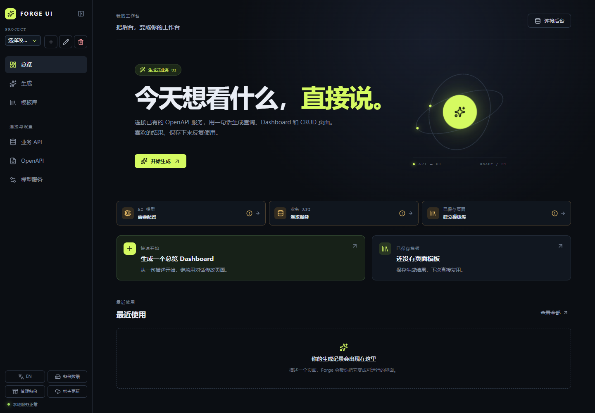
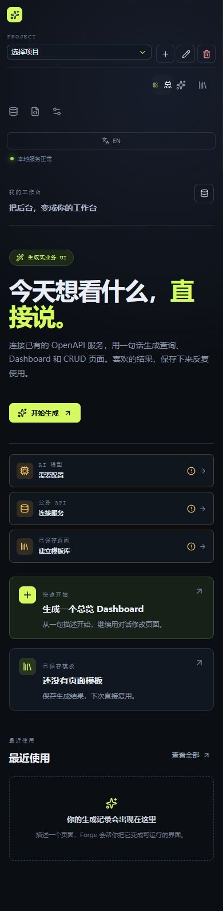

<div align="center">

# Forge UI

**Turn existing OpenAPI services into runnable, reusable business workspaces.**

Connect a business API, describe the page you need in natural language, and get controlled query, dashboard, and CRUD pages. The page structure is validated as a `PageSpec` DSL and executed by the local client.

[简体中文](README.md) | English

[](https://github.com/wh-kerwin/ForgeUI/actions/workflows/ci.yml)
[](https://github.com/wh-kerwin/ForgeUI/actions/workflows/package.yml)


</div>

---

## Overview

Forge UI is a local-first generative business UI desktop client for individual developers, business analysts, and internal-tool users. It connects to existing Swagger/OpenAPI services and generates queryable, actionable, reusable business pages from natural language, removing the need to hand-build a fixed front end for every backend endpoint.

> Connect once, describe the need, get a reusable business workspace.

It is not a low-code editor that lets a model generate and execute arbitrary web code. The model only produces a constrained `PageSpec`; the client performs schema validation, authorization checks, response mapping, request execution, and rendering.

```text
Swagger / OpenAPI ──┐
                    ├──> Rust core ──> PageSpec from model ──> React renderer
Model provider ─────┘        │                                  │
                             ├──> business API executor <───────┘
                             ├──> SQLite
                             └──> system keychain
```

## Client preview

| Desktop workspace                                                                            | Mobile layout                                                                            |
| -------------------------------------------------------------------------------------------- | ---------------------------------------------------------------------------------------- |
|  |  |

## Capabilities

| Capability                | Description                                                                                                                                                               |
| ------------------------- | ------------------------------------------------------------------------------------------------------------------------------------------------------------------------- |
| Model providers           | Configure and test OpenAI Compatible or Anthropic Compatible services with base URL, model, API key, custom headers, and generation parameters.                           |
| API connections           | Import Swagger 2.0 and OpenAPI 3.0/3.1 documents from a spec URL, a Swagger UI URL, or local JSON/YAML files.                                                             |
| API-aware generation      | Select matching, authorized operations for the user's goal. Missing resources or capabilities stop generation instead of falling back to unrelated APIs.                  |
| Explicit response mapping | Build a bounded summary from success response schemas and bind items, total, record IDs, and fields with RFC6901 JSON Pointers; mappings require confirmation.            |
| Controlled pages          | Render filters, tables, stats, charts, detail views, and CRUD from the `PageSpec` DSL. Model-produced HTML, CSS, or JavaScript is never executed.                         |
| CRUD workflows            | CRUD pages expose real API filters, a command bar, a table, and pagination. Create, edit, detail, and delete run through overlays; delete requires confirmation.          |
| Templates and history     | Save pages as versioned templates with search, pinning, renaming, version restore, import/export, and generation history.                                                 |
| Data export               | CSV/XLSX export is user-initiated and contains only the currently loaded display values; templates and export payloads never contain keys, tokens, or system credentials. |
| Local-first               | SQLite stores configuration and page metadata; model keys, business tokens, and sensitive headers are written only to the system keychain.                                |

### Data and runtime

- **Definition and data are separate**: query results go into runtime state only and are never written back into the `PageSpec`. Templates store a pure page definition; records, selection, and diagnostics stay out of templates and generation history.
- **Unambiguous record identity**: record IDs keep their original type, so `string:001` and `number:1` never collide. Missing or duplicate IDs surface a diagnostic and disable row writes and batch actions for the affected rows.
- **Explicit status semantics**: idle, loading, success, empty, error, and cancelled are distinct. A failed query keeps the previous data visible but marks it stale and disables writes; when the API reports no total, the UI never guesses one.
- **Labeled display scope**: stat cards state their scope, show no numbers before data is loaded, and never present a current-page aggregate as a total. Formatting issues affect only the corresponding chart region and produce a diagnostic.
- The default generation and save path still uses the v1 `PageSpec`. The v2 contract, explicit response mapping, and runtime separation are implemented, but default v2 writes stay disabled until persistence projections, export re-validation, and migration entry points are complete.

## From API to page

1. Configure and test a model provider.
2. Import an OpenAPI document, set up business authentication, and authorize the operations that may be used.
3. Describe the goal in the generation workbench, for example "generate a product management page".
4. Forge UI passes only the matching operations and parameters as generation context, validates the returned `PageSpec`, and then renders the page. Response fields are read through the confirmed mapping instead of guessed shapes.
5. Filters, pagination, and CRUD use the real parameters and paths of that operation. Pages worth keeping can be saved as templates.

## Quick start

### Prerequisites

- Node.js 22 or newer (CI pins 22)
- npm
- Rust 1.88 or newer (the repository toolchain file uses `stable`)
- [Tauri 2 platform prerequisites](https://v2.tauri.app/start/prerequisites/)

On Windows you also need Microsoft C++ Build Tools and WebView2; on macOS you need the Xcode Command Line Tools.

### Install and run

```bash
git clone https://github.com/wh-kerwin/ForgeUI.git
cd ForgeUI
npm ci
npm run tauri:dev
```

Model and business services are configured inside the client; no `.env` file is needed.

`npm run dev` starts only the browser preview. SQLite, the system keychain, Rust network requests, and Tauri IPC require `npm run tauri:dev`.

## Common commands

| Command                                                               | Purpose                                                      |
| --------------------------------------------------------------------- | ------------------------------------------------------------ |
| `npm run dev`                                                         | Start the Vite browser preview.                              |
| `npm run tauri:dev`                                                   | Start the desktop client in development mode.                |
| `npm test`                                                            | Run `tests/*.test.ts` unit tests.                            |
| `npm run test:ui`                                                     | Run component tests under `tests/ui/`.                       |
| `npm run build`                                                       | Type-check with TypeScript and build the front end.          |
| `npm run lint`                                                        | Run ESLint.                                                  |
| `npm run format:check`                                                | Check formatting with Prettier.                              |
| `npm run contract:check`                                              | Verify generated `PageSpec` types and schema are up to date. |
| `npm run preview`                                                     | Preview the production front-end build.                      |
| `npm run tauri:build`                                                 | Build desktop installers.                                    |
| `npm run validate:updater`                                            | Validate the updater configuration.                          |
| `cargo fmt --manifest-path src-tauri/Cargo.toml -- --check`           | Check Rust formatting.                                       |
| `cargo test --manifest-path src-tauri/Cargo.toml --lib`               | Run Rust unit tests.                                         |
| `cargo check --manifest-path src-tauri/Cargo.toml --features updater` | Check the Rust build with the updater feature.               |

## Tech stack

| Layer           | Technology                                    |
| --------------- | --------------------------------------------- |
| Desktop runtime | Tauri 2                                       |
| Front end       | React, TypeScript, Vite, Ant Design, Recharts |
| State           | Zustand                                       |
| Rust core       | Rust, Serde, Reqwest, rustls                  |
| Local data      | SQLite, rusqlite                              |
| Credentials     | Windows Credential Manager, macOS Keychain    |
| Data export     | CSV, rust_xlsxwriter                          |
| Tests           | `node:test`, Vitest, Testing Library, jsdom   |
| Icons           | Lucide React                                  |
| Automation      | GitHub Actions                                |

## Security boundaries

- The React WebView never calls model providers, Swagger endpoints, or business APIs directly. Requests, TLS, credential access, and persistence all go through Rust/Tauri IPC.
- The model receives page structure and authorized operations only, never loaded business data, tokens, or API keys.
- The Rust layer re-checks the OpenAPI operation allow-list and `PageSpec` bindings; unauthorized or mismatched operations cannot execute.
- Response mapping resolves local JSON Pointers only, rejecting prototype-polluting property names and expressions. Business response values never enter the model context or diagnostic text.
- Model, OpenAPI, and business API responses are size-bounded. Public endpoints require HTTPS; local and private network addresses (loopback, RFC1918, link-local, IPv6 ULA, `localhost`/`.local`) may use HTTP, and URLs must not contain credentials.
- Create, edit, and delete require an explicit user action, and delete needs a second confirmation. Writes are automatically disabled for stale results, unbound endpoints, or unresolved record identities.

## Project structure

```text
ForgeUI/
├─ .github/workflows/        # CI and desktop installer builds
├─ artifacts/                # README and regression screenshots
├─ contracts/                # Authoritative PageSpec v2 schema and shared fixtures
├─ docs/                     # Product, design, planning, optimization, and release docs
├─ scripts/                  # Contract generation, test loader, and validation scripts
├─ src/                      # React front end
│  ├─ features/              # Workbench, connections, models, pages, templates, sessions
│  │  └─ pages/runtime/      # Runtime state and display selectors
│  ├─ i18n/                  # Localized UI strings
│  ├─ lib/tauri/             # Tauri IPC wrappers
│  ├─ store/                 # Zustand state and business requests
│  └─ types/                 # TypeScript domain types
├─ src-tauri/src/            # Tauri and Rust core
│  ├─ domain/                # PageSpec domain model and schema validation
│  ├─ repositories/          # SQLite, migrations, configuration, secret storage
│  └─ services/              # Models, OpenAPI, business API, export, URL safety
└─ tests/                    # Unit tests and UI component tests
```

## Documentation and releases

All project documents below are written in Chinese.

- [Product requirements](docs/PRD.md)
- [Implementation plan](docs/PLAN.md)
- [Design notes](docs/DESIGN.md)
- [Optimization proposal](docs/OPTIMIZATION.md)
- [Implementation status](docs/implementation-status.md) (historical; some figures are outdated)
- [Domain glossary](CONTEXT.md)
- [Architecture decision record](docs/adr/0001-tauri-and-model-adapters.md)
- [Release and toolchain](docs/RELEASE_AND_TOOLCHAIN.md)
- [Release notes](docs/release.md)
- [B2B optimization execution log](docs/optimization/b2b-execution-log.md)

On pushes to `main` and on pull requests, CI runs contract, format, lint, build, test, dependency audit, and Rust checks on Windows and macOS. Publishing a release or triggering the packaging workflow manually produces a Windows MSI and a macOS DMG under `src-tauri/target/release/bundle/`.

> This repository does not yet include an open-source license file. Clarify the license and third-party dependency compliance strategy before publishing or redistributing.
