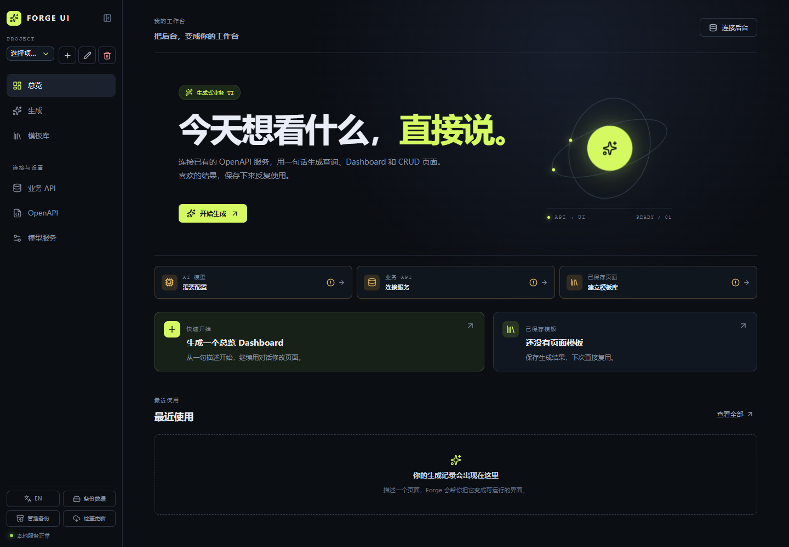
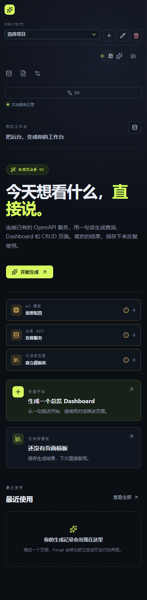

<div align="center">

# Forge UI

**把已有的 OpenAPI 服务，变成可运行、可复用的业务工作台。**

连接业务 API，用一句自然语言生成受控的查询、看板与 CRUD 页面；页面结构由 `PageSpec` DSL 校验，并由本地客户端执行。

简体中文 | [English](README.en.md)

[产品需求](docs/PRD.md) · [设计说明](docs/DESIGN.md) · [实现计划](docs/PLAN.md) · [发布说明](docs/release.md) · [B 端验收报告](docs/optimization/b2b-acceptance-report.md) · [执行记录](docs/optimization/b2b-execution-log.md)

[](https://github.com/wh-kerwin/ForgeUI/actions/workflows/ci.yml)
[](https://github.com/wh-kerwin/ForgeUI/actions/workflows/package.yml)


</div>

---

## 概览

Forge UI 是一个本地优先的生成式业务 UI 桌面客户端，面向个人开发者、业务分析师和内部工具使用者。它连接已存在的 Swagger/OpenAPI 服务，通过自然语言生成可查询、可操作、可保存复用的业务页面，减少为每个后台接口重复开发固定前端的工作。

> 连接一次，描述需求，得到可复用的业务工作台。

它不是让模型任意生成和执行网页代码的低代码编辑器。模型仅生成受控的 `PageSpec` 页面描述；客户端完成结构校验、权限校验、数据映射、请求执行与页面渲染。

```text
Swagger / OpenAPI ──┐
                    ├──> Rust 核心 ──> 模型生成 PageSpec ──> React 页面渲染器
模型服务 ───────────┘        │                                 │
                             ├──> 业务 API 执行器 <────────────┘
                             ├──> SQLite
                             └──> 系统钥匙串
```

## 客户端预览

| 桌面工作台                                                                            | 移动端适配                                                                           |
| ------------------------------------------------------------------------------------- | ------------------------------------------------------------------------------------ |
|  |  |

## 核心能力

| 能力         | 说明                                                                                                             |
| ------------ | ---------------------------------------------------------------------------------------------------------------- |
| 模型服务     | 配置和测试 OpenAI Compatible 或 Anthropic Compatible 服务，支持 Base URL、模型、密钥、自定义 Header 与生成参数。 |
| API 连接     | 从规范 URL、Swagger UI 地址或本地 JSON/YAML 导入 Swagger 2.0、OpenAPI 3.0/3.1 文档。                             |
| API 感知生成 | 根据用户目标筛选匹配的已授权 operation；请求的业务资源或能力不存在时停止生成，不以其他资源的数据替代。           |
| 显式响应映射 | 从成功响应 Schema 生成有界摘要，用 RFC6901 JSON Pointer 显式绑定列表、总数、记录 ID 与字段；映射需用户确认。     |
| 受控页面     | 使用 `PageSpec` DSL 渲染筛选、表格、统计、图表、详情和 CRUD，不执行模型返回的 HTML、CSS 或 JavaScript。          |
| CRUD 工作流  | CRUD 页面提供真实 API 对应的筛选项、命令栏、表格与分页；新增、编辑、详情和删除通过弹窗完成，删除需确认。         |
| 模板与历史   | 保存页面为模板，支持搜索、固定、重命名、版本恢复、导入导出和生成历史。                                           |
| 数据导出     | CSV/XLSX 由用户主动触发，仅导出当前已加载的展示值；模板与导出载荷不包含密钥、Token 或系统凭证。                  |
| 本地优先     | SQLite 保存配置和页面元数据；模型密钥、业务 Token 与敏感 Header 仅写入系统钥匙串。                               |

### 数据与运行时

- **定义与数据分离**：查询结果只进入运行时状态，不写回 `PageSpec`。模板保存的是纯页面定义，记录、选择和诊断不会进入模板或生成历史。
- **明确的记录身份**：记录 ID 按原始类型区分，例如 `string:001` 与 `number:1` 不冲突；缺失或重复 ID 会显示诊断并禁用对应行的写入与批量操作。
- **状态语义**：区分待加载、加载中、成功、空结果、错误和已取消；查询失败时保留旧数据但明确标记「已过期」并禁用写入，接口未提供总数时不猜测总数。
- **展示范围**：统计卡片标注「仅当前页」或「服务端聚合」；未绑定统计端点显示未绑定，部分统计失败保留独立错误区而不吞成 0，截断结果明确标记。
- **局部修改与模板**：修改页面先预览语义 diff 再应用/放弃，保留一份可撤销上版本；模板加载、导入与版本恢复都显示绑定状态，失效或跨项目文档必须显式重绑定。
- 当前默认仍使用 v1 `PageSpec` 生成与保存。v2 契约、显式响应映射、结构 allowlist 投影、持久化再验证、迁移预览与跨项目重绑定已具备；但 **v2 runtime 与写入入口尚未接入**，默认写入按计划保持关闭，统计端点的实际 HTTP 拉取也待该接入闭合。真实模型 live 评测与本地桌面端到端 smoke 均未运行，详见 [验收报告](docs/optimization/b2b-acceptance-report.md)。

## 从 API 到页面

1. 配置并测试一个模型服务。
2. 导入 OpenAPI 文档，设置业务认证并授权可用 operation。
3. 在生成工作台描述需求，例如「生成商品管理界面」。
4. Forge UI 只将匹配资源的 operation 与参数作为生成上下文，校验模型返回的 `PageSpec` 后再渲染页面；响应字段通过已确认的映射读取，不猜测数据结构。
5. 筛选、分页和 CRUD 操作按该 operation 的真实参数与路径执行；满意的页面可保存为模板复用。

## 快速开始

### 环境要求

- Node.js 22 或更高版本（CI 固定使用 22）
- npm
- Rust 1.88 或更高版本（仓库工具链配置使用 `stable`）
- [Tauri 2 对应平台的系统依赖](https://v2.tauri.app/start/prerequisites/)

Windows 开发还需要 Microsoft C++ Build Tools 与 WebView2；macOS 开发需要 Xcode Command Line Tools。

### 安装与运行

```bash
git clone https://github.com/wh-kerwin/ForgeUI.git
cd ForgeUI
npm ci
npm run tauri:dev
```

模型和业务服务都在客户端中配置，不需要创建 `.env` 文件。

`npm run dev` 仅启动浏览器端界面预览。SQLite、系统钥匙串、Rust 网络请求与 Tauri IPC 需要通过 `npm run tauri:dev` 运行。

## 常用命令

| 命令                                                                  | 说明                                           |
| --------------------------------------------------------------------- | ---------------------------------------------- |
| `npm run dev`                                                         | 启动 Vite 浏览器预览。                         |
| `npm run tauri:dev`                                                   | 启动桌面客户端开发模式。                       |
| `npm test`                                                            | 运行 `tests/*.test.ts` 前端单元测试。          |
| `npm run test:ui`                                                     | 运行 `tests/ui/` 下的组件测试。                |
| `npm run build`                                                       | 执行 TypeScript 检查并构建前端。               |
| `npm run lint`                                                        | 运行 ESLint 检查。                             |
| `npm run format:check`                                                | 运行 Prettier 格式检查。                       |
| `npm run contract:check`                                              | 校验生成的 `PageSpec` 类型与 Schema 是否最新。 |
| `npm run preview`                                                     | 预览前端生产构建。                             |
| `npm run tauri:build`                                                 | 构建桌面客户端安装包。                         |
| `npm run validate:updater`                                            | 校验更新器配置。                               |
| `cargo fmt --manifest-path src-tauri/Cargo.toml -- --check`           | 检查 Rust 格式。                               |
| `cargo test --manifest-path src-tauri/Cargo.toml --lib`               | 运行 Rust 单元测试。                           |
| `cargo check --manifest-path src-tauri/Cargo.toml --features updater` | 检查带更新器功能的 Rust 编译。                 |

## 技术栈

| 层级       | 技术                                          |
| ---------- | --------------------------------------------- |
| 桌面运行时 | Tauri 2                                       |
| 前端       | React、TypeScript、Vite、Ant Design、Recharts |
| 状态管理   | Zustand                                       |
| Rust 核心  | Rust、Serde、Reqwest、rustls                  |
| 本地数据   | SQLite、rusqlite                              |
| 凭证存储   | Windows Credential Manager、macOS Keychain    |
| 数据导出   | CSV、rust_xlsxwriter                          |
| 测试       | `node:test`、Vitest、Testing Library、jsdom   |
| 图标       | Lucide React                                  |
| 自动化     | GitHub Actions                                |

## 安全边界

- React WebView 不直接请求模型服务、Swagger 服务或业务 API；请求、TLS、凭证读取和数据持久化全部经由 Rust/Tauri IPC。
- 模型只接收页面结构和已授权 operation，不接收已加载的真实业务数据、Token 或 API Key。
- OpenAPI operation 允许列表和 `PageSpec` 绑定由 Rust 层复核，未授权或不匹配的操作不会执行。
- 响应映射只使用本地 JSON Pointer 解析，拒绝原型污染属性名与表达式；业务响应值不进入模型上下文或诊断文本。
- 模型、OpenAPI 与业务 API 响应都有长度限制；公网地址必须使用 HTTPS，本地与局域网地址（loopback、RFC1918、link-local、IPv6 ULA、`localhost`/`.local`）允许 HTTP，URL 内不得包含凭证。
- 新增、编辑、删除必须由用户主动提交，删除操作需要二次确认；查询过期、未绑定接口或记录身份不明时，写入能力自动禁用。

## 项目结构

```text
ForgeUI/
├─ .github/workflows/        # 持续集成与桌面安装包构建
├─ artifacts/                # README 与回归截图
├─ contracts/                # PageSpec v2 权威 Schema 与共享样例
├─ docs/                     # 产品、设计、计划、优化与发布文档
├─ scripts/                  # 契约生成、测试加载器与校验脚本
├─ src/                      # React 前端
│  ├─ features/              # 工作台、连接、模型、页面、模板与会话
│  │  └─ pages/runtime/      # 运行时状态与展示选择器
│  ├─ i18n/                  # 中英文界面
│  ├─ lib/tauri/             # Tauri IPC 调用封装
│  ├─ store/                 # Zustand 状态与业务请求
│  └─ types/                 # TypeScript 领域类型
├─ src-tauri/src/            # Tauri 与 Rust 核心
│  ├─ domain/                # PageSpec 领域模型与 Schema 校验
│  ├─ repositories/          # SQLite、迁移、配置和密钥存储
│  └─ services/              # 模型、OpenAPI、业务 API、导出与 URL 安全
└─ tests/                    # 前端单元测试与 UI 组件测试
```

## 文档与发布

- [产品需求](docs/PRD.md)
- [实现计划](docs/PLAN.md)
- [设计说明](docs/DESIGN.md)
- [优化方案](docs/OPTIMIZATION.md)
- [实现状态](docs/implementation-status.md)（历史记录，部分数据已过时）
- [领域术语](CONTEXT.md)
- [架构决策](docs/adr/0001-tauri-and-model-adapters.md)
- [发布与工具链](docs/RELEASE_AND_TOOLCHAIN.md)
- [版本发布说明](docs/release.md)
- [B 端优化执行记录](docs/optimization/b2b-execution-log.md)

持续集成在推送到 `main` 和提交 Pull Request 时，对 Windows 与 macOS 执行契约、格式、lint、构建、测试、依赖审计及 Rust 门禁。发布 Release 或手动触发打包工作流时生成 Windows MSI 与 macOS DMG，产物位于 `src-tauri/target/release/bundle/`。

> 当前仓库尚未附带开源许可证文件。发布或复用前，请先明确许可证与第三方依赖合规策略。
