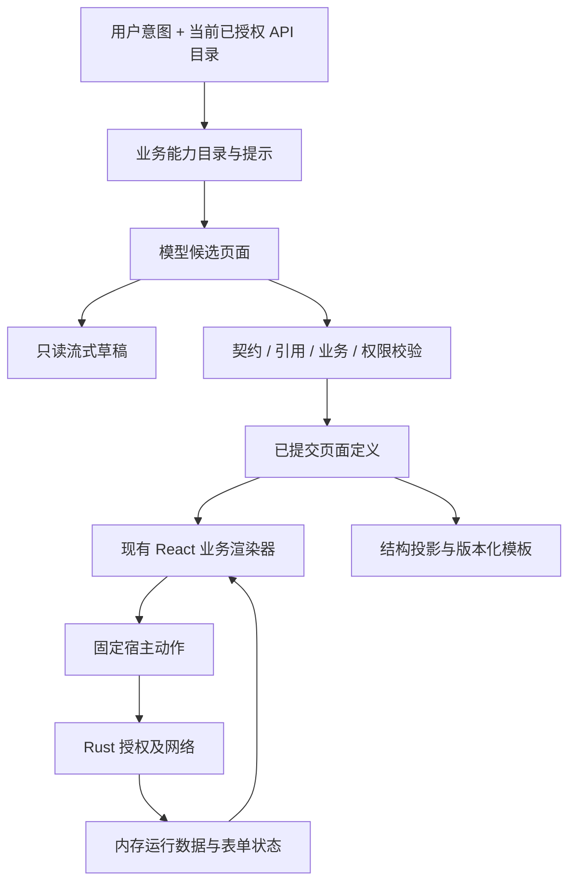

# Forge UI：B 端生成式业务工作台优化设计

状态：待实施。日期：2026-10-22。对应[研究依据](../research/json-render-design-study-2026-10-22.md)、[Claude 执行计划](../plans/2026-10-22-b2b-generative-ui-implementation.md)、[架构决策](../adr/0002-b2b-page-contract-and-runtime.md)。

本文确定本轮 B 端方向。旧 PRD 的“C 端”定位、旧优化文档的完成状态不能覆盖本设计；历史文档保留用于追溯。本文件中的新接口与路径均为计划，不代表已经实现。

## 1. 产品边界与优先级

核心用户是使用现有业务 API 的运营、实施、业务分析和内部系统开发者。目标任务是：选项目与 API 文档，描述工作台，生成可查可操作的页面，校正字段和绑定，保存可复用模板。

| 优先级 | 能力                                 | 首轮成功标准                                             |
| ------ | ------------------------------------ | -------------------------------------------------------- |
| P0     | 请求/流式/空状态可靠性、项目隔离     | 旧请求不覆盖新页，取消真生效，空结果无旧记录，草稿无操作 |
| P1     | 查询列表、详情、CRUD、明确数据映射   | 身份不依赖行号，字段类型不丢失，写入有确认和结果         |
| P1     | 能力契约、可解释诊断、模板和局部修改 | 模型只输出支持能力；修改可预览撤销；模板不携带业务数据   |
| P2     | 统计看板与报表的语义完善             | 全量统计来自明确接口；当前页聚合有范围标识               |
| 后续   | 读缓存、更复杂组合                   | 仅在上下文身份和失效策略稳定后考虑                       |

本轮不建设在线协作平台、工作流引擎、通用 RBAC 管理台、任意拖拽搭建器、多端 SDK、动态插件市场、任意脚本/表达式或自动生成业务后端。保留现有看板/图表/kanban 兼容性，但不让这些扩大核心 CRUD 改造。

## 2. 保留与调整

保留 Tauri/Rust 宿主、React、Zustand、Ant Design、Recharts、SQLite、钥匙串、Project → ApiDocument 归属、授权 operation 和现有设计语言。无需换 UI 库或整体视觉改版。

调整四个边界：

1. **能力目录**描述产品会什么；**API 目录**描述当前项目允许调用什么。两者独立，通过绑定校验交汇。
2. **页面定义**描述字段、布局和绑定；**运行状态**保存记录、选择、分页与请求状态。
3. **模型输出**是候选定义；通过契约、引用、业务绑定和权限校验后才成为可执行页面。
4. **模板/模型上下文/会话**默认只接收结构投影；**数据导出**是用户主动触发的独立业务动作。



## 3. 业务能力目录：小而稳定

新增 `src/features/pages/capabilities/businessCapabilityCatalog.ts`。首轮四个场景：query、crud、report、dashboard；kanban 作为现有可选 view，非独立平台。shop/content/social 不再出现在默认新建入口和 few-shot 中；旧自定义提示模板可导入，但不能突破能力契约。

目录项只包含：id、描述、适用场景、相关 Schema `$ref`、必须的 operation roles、支持的 views、固定宿主动作、上限和安全说明。**不要在目录再手写一套字段 Schema**。

| 业务能力  | 必需条件                                         | 缺失时行为                                           |
| --------- | ------------------------------------------------ | ---------------------------------------------------- |
| query     | 可解析的 list operation、数据项映射              | 提示绑定问题，不能拿无关 GET 顶替                    |
| crud      | query + 对应 create/update/delete 授权及参数映射 | 只提供实际可用的动作；用户明确要求缺失动作时说明缺口 |
| report    | query + 已知字段类型                             | 允许当前结果聚合并明确范围，不冒充全量               |
| dashboard | 明确统计接口，或明确当前结果聚合                 | 无来源指标显示“未绑定”，禁生成示例数字冒充事实       |

提示、能力检查和 UI 能力说明从同一目录构建。Renderer 仍是静态注册表；测试保证目录支持的 view/action 有实现。目录不管理 baseUrl、凭证或网络。

## 4. 契约策略与分层校验

以 `contracts/page-definition-v2.schema.json` 为 v2 字段及上限的权威来源，JSON Schema Draft 2020-12。生成 TS 类型；Rust serde 保留显式领域类型，但由共享正反例验证一致性。Rust 使用与此 draft 兼容的校验库验证原始 JSON，再反序列化和业务校验。选库和锁版在实施任务 C1 中完成，禁止只生成 TS 而遗漏宿主入口。

Schema 负责类型、枚举、长度、数量、禁止未知字段；领域代码负责跨字段引用、唯一 key、操作角色/授权、项目归属、字段与响应匹配。provider strict schema 是从权威契约生成的**兼容投影**，不作为安全校验的替代；不能表达的规则留在宿主，记录投影差异。

过渡期 v1 保持原有契约，先补 parity fixtures 和显式版本拒绝。不要先改模型输出 version，再追赶 Rust、模板和导出。

统一问题结构：

```ts
type PageIssue = {
  code: string; // 例如 BINDING_DOCUMENT_DISABLED
  path: string; // JSON Pointer，例如 /dataSources/primary/operationRef
  severity: "error" | "warning";
  stage: "syntax" | "schema" | "reference" | "binding" | "permission";
  message: string;
  suggestedFix?: string; // 用户可理解，不含凭证或真实记录
};
```

校验顺序：长度/JSON → version/schema → 引用与能力 → 当前项目/API 文档绑定 → Rust 执行时再次授权。不存在“前端已经校验所以后端免检”。`permissionRole` 仅是 UI 约束，后端 API 仍须真实鉴权。

## 5. v2 定义与运行状态

v2 是本项目的业务 DSL，不采用 json-render 的通用节点图。下例说明字段关系，不是完整 Schema；完整上限在 C1 实施时落实并由测试锁定。

```json
{
  "version": 2,
  "title": "订单管理",
  "description": "订单查询与维护",
  "dataSources": {
    "primary": {
      "operationRef": "orders.list",
      "itemsPointer": "/data/items",
      "totalPointer": "/data/total",
      "rowKeyPointer": "/id"
    }
  },
  "fields": [
    { "key": "orderId", "label": "订单编号", "valuePointer": "/id", "type": "string" },
    { "key": "amount", "label": "金额", "valuePointer": "/amount", "type": "money" }
  ],
  "operations": [
    {
      "key": "orders.list",
      "apiDocumentId": "doc-orders",
      "operation_id": "listOrders",
      "method": "GET",
      "path": "/orders",
      "role": "list"
    }
  ],
  "filters": [],
  "views": [
    {
      "key": "ordersTable",
      "type": "list",
      "dataSourceRef": "primary",
      "fieldKeys": ["orderId", "amount"]
    }
  ]
}
```

### 5.1 v2 的最小约束

- 顶层保留 title/description/layout/breadcrumb/permissionRole/theme/styleTokens；不允许 rows 或 literal stats.value。生成的新页面没有业务样本。
- `operations` 复用已授权 OperationBinding 的语义，增加唯一 `key`，禁止任意执行字符串。operation 身份由 projectId + apiDocumentId + operation_id + method + path 联合确认，不能只按 operation_id 匹配。
- 初期 `dataSources` 只允许 `primary`，一个列表数据源。P2 才按显式需求扩展具名 stats 数据源；不实现通用 join。
- `itemsPointer` 是相对整个响应的 RFC 6901 Pointer，空字符串表示根数组；`rowKeyPointer`、`valuePointer` 相对单条记录。只允许 Pointer，禁止脚本和通配符执行。
- fields 至多 50；views 至多 10、嵌套深度至多 3；filters 至多 20；operations 至多 20；每次展示最多 100 条记录，沿用现有保护上限并单独记录截断。更大服务端分页由用户翻页，不静默拉取全库。
- field key 是稳定标识；label 可改；值类型沿用 string/number/date/datetime/enum/boolean/money。raw 值不被货币、日期、枚举格式化覆盖。
- filters 使用稳定 key、fieldKey、queryParam、有限 operator 和输入类型；queryParam 必须来自对应 OpenAPI operation。分页与排序参数也按文档显式声明。
- list/chart/kanban/tabs/split 使用稳定 view key 和合法字段引用；图表与看板只能引用已声明 dataSource 和 fields。不存在的引用是错误，不靠自动猜字段掩盖。
- 写操作由受控 bodySchema 和参数映射组成；首轮增加常用 min/max/minLength/maxLength/pattern/nullable/readonly 约束，pattern 应限制长度和复杂度；不实现任意嵌套动态表单。
- 路径参数绑定字段使用 raw 值并编码；缺少明确 ID 则禁用记录写操作。批量写入仅支持已授权专用 endpoint + 明确 ids 映射。legacy customPayload 不自动升级成可执行脚本。
- metric 定义只包含 key/label/sourceRef/valuePointer/format，或明确 `scope: currentPage` 的有限聚合；没有已加载来源时显示未加载，不能拿模型生成值填充。

### 5.2 运行状态的建议接口

```ts
type QueryStatus = "idle" | "loading" | "success" | "empty" | "error" | "cancelled";
type PageRuntimeState = {
  contextKey: string;
  query: { status: QueryStatus; requestId?: string; page: number; pageSize: number };
  records: Record<string, unknown>[];
  total?: number; // 缺少 total 不伪装成全量总数
  truncated: { rows: boolean; columns: boolean };
  selectedRowKeys: string[];
  error?: { code: string; message: string };
};
```

records 保留类型；只接纳 JSON 对象，单元格嵌套对象只做展示序列化，不变成可执行内容。表单 draft 与提交状态另设局部 runtime slice，成功或关闭后清理。records、选择、草稿和错误都不持久化进页面模板。

`rowKey` 使用标明类型的原始 ID，例如 string:001 与 number:1 区分；重复或缺失 ID 显示诊断并禁用对应行写/批量动作，不用索引伪造身份。临时渲染 key 可独立生成，但不能进入 API payload。

### 5.3 映射确定性

优先读取 OpenAPI 的明确响应 Schema 和用户确认的映射。当前 OpenApiSummary 只有 fieldSchemas/queryParameters 等有限信息，需在 Rust `openapi.rs` 和 TS summary **增加 response shape 摘要**，不能假设它今天已有完整响应映射。

用户可在“数据绑定”面板校正 items/total/rowKey/field pointers。使用本地真实响应辅助时只在客户端展示，不能自动发送给模型。缺少样本可从 Schema 建议；需要猜测时显示“待确认映射”。

旧 unwrap/ID-first 仅用于 v1 兼容建议，不能静默决定写操作身份。空数组是成功空状态；映射无效是错误；两者不能同为 null。数量等于 50 列不代表截断，只有实际超过上限才标记。

## 6. 请求与动作状态机

### 6.1 上下文和取消

每次生成/修改/查询捕获不可变上下文：projectId、选定 apiDocumentIds、文档 revision、授权 revision、页面 definition revision、requestId。可用文档 updatedAt 加内容摘要作为第一版 revision，不能只比较项目名。

切项目、切页、更新文档授权或新请求启动时：递增 epoch、取消旧查询/生成、清理选择与相关表单。任何异步结果写入 UI 或保存会话前都检查 contextKey + epoch；包括错误提示与 finally，避免旧请求结束时清除新请求 loading。Rust 执行时独立检查当前授权。

query 的 request_id 放进 ApiRequest 内；cancel 命令的 Tauri 顶层参数命名通过真实 IPC 测试确认。Rust token 生命周期覆盖发送与限长 body 读取；所有返回路径清理；重复 requestId 拒绝，不用空串共享 token。取消只是客户端停止等待，不承诺服务端撤销计算。

### 6.2 写入闭环

idle → editing → validating → confirming（删除/批量）→ submitting → success/error/unknown。

- 提交前宿主验证 operation 归属、参数、raw ID、body allowlist。按钮防重入，不自动重试写操作。
- 成功后关闭对应表单，清除选择，刷新原查询参数下的当前页；删除导致当前页为空时回退到上一有效页一次。
- 失败保留输入和字段级错误，恢复可提交状态，不假装成功。
- 网络中断或取消发生在可能已提交后，标记 unknown，提示刷新核对；不声称事务回滚。
- 批量部分成功给出成功/失败数量与可核对的记录标识，不自动重发全部。
- sort/filter 明确为服务端或当前页本地处理；服务端排序关闭本地 comparator，清除排序必须触发服务端无 sort 查询。

## 7. 流式草稿与局部修改

保留 SSE + JSON，不引入 JSONL patch。草稿最多每 100ms 提交一次，使用单 timer，dirty 在发射前清除；finish 处理最终状态，destroy 后不得发出回调。最终有效页面以 Rust 返回并通过完整校验的定义为准。

草稿通过显式 `mode: preview` 渲染。删除 operations、batchActions 和任何可执行绑定；宿主 action dispatcher 也检查 mode。不能只依赖 disabled fieldset；无自动 query、无 mutation、无保存 session。

修改入口接现有 PageRefineBox。使用原页面结构投影和原授权文档集合生成完整候选，不能并入未明确选择的 active 文档。先展示字段、布局、数据源、operation、权限的 diff；用户应用后才提交新 definition revision，提供一次撤销。改标题/列顺序不重新查询；改绑定后清 runtime/selection，首次 GET 仍走明确校验。

## 8. 模板、迁移与信息边界

新增独立投影函数：forModel、forTemplate、forSession、forDiagnostic。投影显式选字段，不接收任意对象展开。去掉业务 records/metrics/form draft/凭证；检查 title/description、默认表单值、自定义 payload、prompt 中可能夹带的数据。字段名称和用户输入本身可能敏感，不能宣称只清 rows 就绝无敏感信息；产品应提示用户输入会发送给所选模型。

| 边界              | 策略                                                                                                  |
| ----------------- | ----------------------------------------------------------------------------------------------------- |
| 模型请求          | 仅结构、授权 API 元数据、用户输入；真实响应不进入请求或修复上下文                                     |
| 模板与版本        | 纯定义；导出时再次投影；导入后不执行直到绑定核验                                                      |
| 会话              | 结构与生成来源/模型/时间；prompt 由明确的会话保留设置控制，可清除，不用“绝无业务数据”描述原始用户输入 |
| 诊断              | requestId、阶段、错误码、耗时；不记 token、headers、raw body、真实行或完整 prompt                     |
| CSV/XLSX 数据导出 | 用户主动选择当前已加载结果；提示范围/截断，保留表格公式注入防护；不与模板导出共用 payload             |

v1 → v2 采用无损备份 + 有损映射报告，不自动覆盖旧 payload：

1. 继续读取 v1，通过 adapter 生成候选定义；丢弃 rows 和 literal stats 值，保留可解释的布局/列/操作/主题。
2. columns 字符串无法区分标签与键时，创建字段候选并标记映射待确认；不伪装成确定的 valuePointer。
3. 对 apiDocumentId 缺失、operation_id 重名、文档已禁用、rowKey 不确定的旧模板，允许结构预览，禁止相应执行，要求重绑定。
4. 用户确认后另存 v2 新版本；旧版本只用于受控回退，不自动查询或写入。旧业务数据不带到新定义。
5. 导出采用新 `forge-template-v2` envelope；继续导入 v1 后走迁移向导。模板格式版本、PageSpec 版本、模板历史版本是三个不同概念。
6. 新模板格式不包含本地 secretRef/baseUrl。跨项目导入时清除旧 document IDs，展示 operation 签名候选，用户明确映射后保存目标项目 scope。
7. 老数据库可能已有业务 payload。提供一次本地备份与显式净化迁移报告；备份也可能敏感，不能自动外传。回滚应用不回滚授权/净化安全策略；必要时只恢复到只读预览。

Rust storage 的 save/import/export 全部执行结构投影与校验；不依赖调用方“刚好传入干净页面”。数据导出 `exporter.rs` 改用专用 ExportDataset DTO，避免 v1 PageSpec 的 100 行校验意外承担所有导出规则；首轮仍默认只导出当前已加载最多 100 行，不借此扩展为全库导出。

## 9. 验收与非功能目标

- 离线 contract/security/映射 fixtures 全部通过；真实模型质量单独评估，fallback 不计为模型首轮成功。
- 同长度换页、同 ID 跨文档、授权撤销、生成中切项目、慢 body 取消、空数组、重复 ID 均有回归用例。
- 1000 个碎片流输入下，无重复无效提交、无销毁后回调；100ms 为调度目标而非精确网络延迟保证。记录固定硬件上的首次草稿与最终校验耗时，不预设无证据 SLA。
- 关键区域错误可见；无数据、未加载、查询失败、取消、被截断明确区分。
- 文档不能用某次 3/3 复测证明 95% 成功率。评测必须记录模型版本、样本数、首次有效定义率、绑定正确率、可执行率、fallback 率和错误分类。

## 10. 风险与替代方案

最大的改造风险是 v2 同时影响模型、Rust、渲染、存储和导出。因此先完成 P0 修复和 v1 parity，再以兼容 adapter 引入 v2；未完成所有入口的支持前不开默认写入。

直接接 json-render 能更快获得通用组件组合，但不能替代 API 绑定、安全边界、记录身份和数据迁移，还会同时维护两套 DSL。继续仅改 Prompt 成本最低，却无法修复确定性数据问题。本方案选择保留领域渲染器，将复杂度集中在少数深模块：契约、运行时映射、宿主动作和投影迁移。
