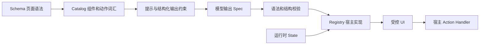

# json-render 设计研究：面向 Forge UI 的取舍

研究日期：2026-10-22。本文是源码研究，不是接入 json-render 的提案。配套的[目标设计](../optimization/b2b-generative-ui-design-2026-10-22.md)与[实施计划](../plans/2026-10-22-b2b-generative-ui-implementation.md)将结论落到本项目。

## 1. 结论

Forge UI 应成为「围绕已授权业务 API 的生成式工作台」：模型负责选择业务能力、组织页面结构和解释配置，宿主负责真实数据、身份、网络、写操作与持久化。

值得学习的是 json-render 对 **Schema、Catalog、Registry、State、Action** 的职责拆分。无需把本项目变成另一个通用 UI SDK，也无需把 PageSpec 换成任意组件树。先修现有可靠性问题，再建立少量 B 端能力的共同契约，收益更直接。

## 2. 研究基线与证据

上游固定提交：`72568f990e5502c4d3115691facb8ca928a5c9fc`。本地项目基线：`84ff7ffcbf6477f4f6520da24b2ae6b782a5f9a8`，main，2026-10-21。后续执行如基线变化，应重新核对涉及文件，不把本文的行号当作永久定位。

| 上游源码                                                                                                                                                   | 重点                                                           |
| ---------------------------------------------------------------------------------------------------------------------------------------------------------- | -------------------------------------------------------------- |
| [core/schema.ts](https://github.com/vercel-labs/json-render/blob/72568f990e5502c4d3115691facb8ca928a5c9fc/packages/core/src/schema.ts)                     | defineSchema、defineCatalog；从目录生成提示、Schema 和校验接口 |
| [core/types.ts](https://github.com/vercel-labs/json-render/blob/72568f990e5502c4d3115691facb8ca928a5c9fc/packages/core/src/types.ts)                       | Spec、UIElement、动态引用与 SpecStream patch/compiler          |
| [react/schema.ts](https://github.com/vercel-labs/json-render/blob/72568f990e5502c4d3115691facb8ca928a5c9fc/packages/react/src/schema.ts)                   | React 所用的页面语法                                           |
| [react/renderer.tsx](https://github.com/vercel-labs/json-render/blob/72568f990e5502c4d3115691facb8ca928a5c9fc/packages/react/src/renderer.tsx)             | Registry、Renderer、属性解析、事件与错误边界                   |
| [core/actions.ts](https://github.com/vercel-labs/json-render/blob/72568f990e5502c4d3115691facb8ca928a5c9fc/packages/core/src/actions.ts)                   | 事件到宿主动作的绑定、确认与结果分支                           |
| [core/state-store.ts](https://github.com/vercel-labs/json-render/blob/72568f990e5502c4d3115691facb8ca928a5c9fc/packages/core/src/state-store.ts)           | 小型状态存储接口                                               |
| [react/contexts/state.tsx](https://github.com/vercel-labs/json-render/blob/72568f990e5502c4d3115691facb8ca928a5c9fc/packages/react/src/contexts/state.tsx) | React 中的状态订阅与引用解析                                   |
| [core/spec-validator.ts](https://github.com/vercel-labs/json-render/blob/72568f990e5502c4d3115691facb8ca928a5c9fc/packages/core/src/spec-validator.ts)     | 根、子节点与结构引用的诊断                                     |
| [streaming 文档](https://github.com/vercel-labs/json-render/blob/72568f990e5502c4d3115691facb8ca928a5c9fc/apps/web/content/docs/streaming.mdx)             | 增量生成如何进入渲染链                                         |

本次阅读了上述关键实现及相应测试、目录和数据绑定文档，没有运行上游测试，也没有对所有 renderer 做行为验证。本文中“可借鉴”表示设计适用性，不代表生产安全或业务正确性由上游保证。

## 3. 核心设计是约束生成空间

普通生成网页让模型输出 HTML/JS，宿主很难确认它会执行什么。json-render 让模型输出已知语法中的 JSON，再由应用注册的代码解释执行。

### 3.1 Schema 是语法，Catalog 是词汇，Registry 是执行体

- Schema 决定页面如何表示，例如节点、子节点、属性和状态引用。
- Catalog 声明哪些组件、动作可用，以及参数、描述和 slots。它可以产出 `prompt()`、`jsonSchema()`、`validate()`、`zodSchema()`。
- Registry 将目录中的名字映射成可信 React 组件和动作实现。

模型可见的能力和应用真正支持的能力因此更容易保持一致。新增组件时，不必分别手写一份无关联的提示示例和渲染分支。

但这并非消除一切重复：组件的语义、API 权限和实际 handler 仍需实现；Schema 转换还受目标模型的结构化输出子集限制。动态 Record 等结构不能假定在所有 strict JSON Schema 提供方上都无损。Forge UI 应保留 provider 兼容性投影与最终宿主校验。

### 3.2 平面节点图解决通用组合与局部更新

Spec 的核心是 `root` 加 `elements` 字典，节点使用稳定 key，children 引用其他节点。相较深层嵌套 JSON，这适合按节点补全、替换、诊断、复用局部结构。

代价是新增图完整性问题：root 不存在、children 引用不存在、孤儿节点、生成中暂时不完整等。结构校验因此必须与属性 Schema 校验分离。

Forge UI 的页面以列表、筛选、表单、图表为主，现有 views 已能表达 tabs/split。现在迁移到任意 root/elements 图，新增的校验、迁移和编辑复杂度大于实际收益。保留业务 DSL，只给视图和字段添加稳定标识即可支撑修改和诊断。

### 3.3 Spec 描述显示方式，State 提供显示内容

上游通过 `$state`、`$item`、`$index`、`$bindState` 等引用连接动态数据和控件，StateStore 通过 get/set/update/snapshot/subscribe 提供小接口。页面结构不必承载每次请求回来的整批记录。

Forge UI 目前把真实 rows 写回 PageSpec，并用响应字段覆盖 columns。页面定义、展示数据、记录身份混在一起，导致模板复用、选择状态、字段引用与隐私边界都变脆弱。这里应学职责分离，不必引入通用表达式解析器；使用受限 JSON Pointer、字段 key 和宿主查询状态已足够。

### 3.4 Action 是宿主能力调用，不是模型生成函数

上游允许声明事件、参数、确认和成功/失败分支，实际执行由应用 handler 提供。这使组件只关心“发出什么事件”，业务程序决定“事件能否执行”。

该机制本身不构成鉴权或网络沙箱。注册的 handler 仍可做危险事情，visible 也不是权限。Forge UI 的 Rust allowlist、项目/API 文档隔离和钥匙串应继续作为最终边界。只开放 query、openDetail、openCreate、submitUpdate、confirmDelete、exportCurrent 等小量固定动作，不开放任意 URL、JavaScript 或 eval。

### 3.5 Streaming 是协议、调度、校验三件事

上游 SpecStream 使用 JSONL patch，核心 parser/compiler 位于 `core/types.ts`。一条完整 patch 可以渐进更新页面，但网络分片不等于完整 JSONL 行；patch 也可能暂时指向尚未到达的节点。

优点是局部更新和更早出现结构；成本是 patch 顺序、路径、缓存、最终图校验与错误恢复。Forge UI 已有 SSE、部分 JSON 修复和最终 Rust 校验。近期应修好现有单一调度器和草稿禁执行机制，暂不增加第二种生成协议。

### 3.6 校验应分层，失败应可解释

上游 spec-validator 输出带 severity/code/elementKey 的问题，说明“JSON 合法”和“页面结构可用”应分开判断。业务系统还需要第三层：该字段是否存在、操作是否授权、查询与写入参数是否满足契约。

上游 React 的元素错误边界在当前版本会返回 null。对 B 端，关键区域静默消失可能让用户误判数据或操作是否成功。Forge UI 应保留区域占位、错误编号和重试入口，并记录无敏感信息的诊断。

## 4. 本项目现状：已有骨架，问题集中在闭环

| 现有能力 / 证据                                                   | 判断和影响                                                                                          |
| ----------------------------------------------------------------- | --------------------------------------------------------------------------------------------------- |
| `src/types/domain.ts`、Rust `domain/page_spec.rs`                 | 已有受控 DSL、业务操作和多视图；无需另起渲染体系                                                    |
| 项目/API 文档目录、`openApiOperations.ts`、Rust `business_api.rs` | 已有多文档授权和宿主网络；要强化身份与请求上下文，不能退化为前端 fetch                              |
| `DataTable.tsx`、`MutationPanel.tsx`                              | 已用 Ant Design、表单验证、表格虚拟化；不是缺一套 UI 库                                             |
| `Workbench.tsx`、`StreamingPageParser`                            | 已有流式生成、一次结构化重试和 API fallback；应修可靠性并明确 fallback 来源                         |
| `PageRefineBox.tsx`、`Workbench.refinePage`                       | 修改逻辑存在，尚未接到可用界面；需要补 diff/应用/撤销流程                                           |
| `modelSafePageSpec.ts`                                            | 已有清空 rows/stats 的模型投影；不能误写成完全没有隔离                                              |
| `useWorkbenchPersistence.saveSession`、`storage.rs`               | 会话保存 page payload；模板导出取库存 payload，不在导出时重新结构化净化；需要全链路投影与旧数据处理 |

### 4.1 先修的实际缺陷

1. **取消链路未闭合。** 前端 execute_api 把 request_id 放在 request 外，而 Rust ApiRequest 从 request 内读取；Rust `cancel_query` 移除 token 却没有调用 `cancel()`。当前请求 token 在响应头返回后移除，未覆盖读 body；异常路径清理也需要测试。Tauri cancel 参数大小写还需真实 IPC 验证。
2. **流式合并调度会重复。** coalesce 同时安排 RAF 和 timer，发射后未清空 latestPartial，并可能覆盖 timer 引用。应使用一个调度器，明确定义 finish/destroy 与最后一次提交。
3. **空结果保留旧记录。** realDataMapping 遇到空列表返回 null，query 分支只提示而不清空旧 rows/total；用户可能把上一批数据当成本次结果。
4. **展示契约被返回数据改写。** 查询用字段键覆盖 columns，旧 columnMeta 被过滤，图表/布局引用可能失配；数据被全部转为 string，记录 ID 与展示值没有严格分离。
5. **选择依赖行索引。** DataTable 使用 rowIndex 作为 key/selection，同长度换页或排序后可能选中其他记录。清除排序也没有完整传递到服务端。
6. **多份契约漂移。** TS 类型、前端解析、Rust serde/validate、手写 provider Schema 和提示各维护一份；前端与 Rust 的版本、数量和引用规则不完全一致。
7. **构建先有阻断。** 本次 `cargo test --lib` 在依赖解析即失败：tokio-util 0.7.19 没有所声明的 sync feature。修复构建是实施第一道门禁，不能先声称取消逻辑已验证。

以上来自源码和基线检查；本次没有运行桌面端网络复现，不把静态风险扩大成“所有用户都已发生数据误操作”。

## 5. 借鉴矩阵

| json-render 思路                                  | Forge UI 的做法                                                    | 本轮决策           |
| ------------------------------------------------- | ------------------------------------------------------------------ | ------------------ |
| Catalog 驱动提示与约束                            | 小型 BusinessCapabilityCatalog，引用统一业务契约                   | 采用               |
| Registry 绑定可信实现                             | 现有 PageViewRenderer/FieldRenderer/宿主 actions，增加明确能力匹配 | 改造现有实现       |
| Spec 与 State 分离                                | PageDefinition + 内存 PageRuntimeState                             | 采用，配套 v1 迁移 |
| 结构化诊断                                        | 路径、错误码、阶段、修复建议；区分重试和 fallback                  | 采用               |
| 通用 state 表达式                                 | JSON Pointer、字段 key、有限 visibleWhen                           | 收窄               |
| root/elements 图                                  | 保留领域 PageSpec 与有限 views                                     | 暂不采用           |
| JSONL patch                                       | 先保留 SSE + 完整 JSON 最终校验                                    | 延后               |
| 多 renderer、多状态适配器、MCP/3D/视频/邮件等生态 | React + Tauri 单端业务工作台                                       | 不进入本轮         |
| 通用动作系统                                      | 只允许已授权的业务 operation 和固定宿主动作                        | 收窄               |
| 静默区域错误恢复                                  | B 端显示失败区域与可追踪诊断                                       | 不照搬             |

## 6. 设计沉淀

生成式 B 端 UI 的质量不由组件数量衡量，而由四个闭环衡量：

- **生成闭环：** 用户意图 → 可用能力 → 被验证的页面 → 可解释的失败。
- **数据闭环：** API 响应 → 明确映射 → 稳定身份 → 准确展示 → 空/错/截断状态。
- **操作闭环：** 用户确认 → 宿主授权 → 执行 → 明确结果 → 当前查询刷新。
- **复用闭环：** 纯页面模板 → 目标 API 重绑定 → 兼容校验 → 可回退迁移。

模型不应解决数据完整性、鉴权、网络取消或记录身份。把这些留给确定性的宿主代码，才能让自然语言配置真正减少业务开发成本。
